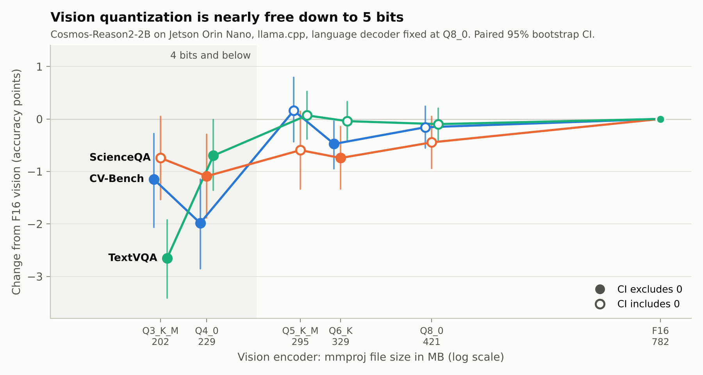
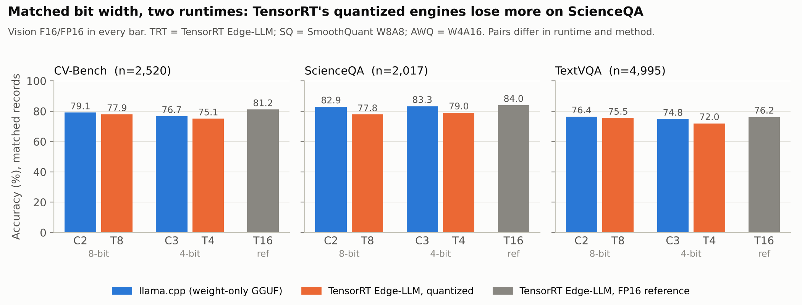
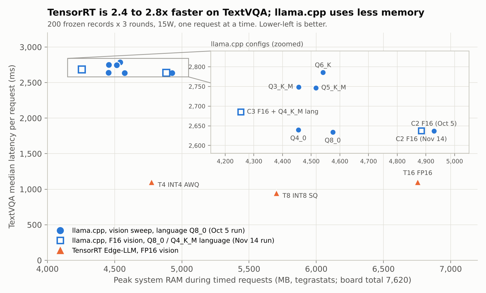

# Vision Encoder Quantization Sensitivity in Driving VLMs on Jetson Edge Hardware

## Team

- Yiang Shen, MS Computer Engineering (llama.cpp pipeline, vision sweep, latency benchmark, vLLM test)
- Maximilian Garcia, MS Artificial Intelligence (TensorRT Edge-LLM pipeline: quantization, engine build on JetPack 6.2, runner and latency benchmark; see [`tensorrt/NOTES.md`](tensorrt/NOTES.md))

**Advisor:** Prof. Kaikai Liu, SJSU

## Abstract

Compact vision-language models (VLMs) are emerging as practical candidates for autonomous driving reasoning on edge platforms, but deploying them within the strict memory budgets of devices like the Jetson Orin Nano (8 GB) demands aggressive quantization. Prior work on VLM quantization has reported that vision encoders can be more sensitive to precision reduction than language decoders, yet this has mostly been characterized on general-purpose benchmarks using server-class hardware, not on spatial reasoning benchmarks or memory-constrained edge devices.

This project isolates and measures vision encoder quantization sensitivity in Cosmos-Reason2-2B (NVIDIA's physical-world reasoning model built on the Qwen3-VL architecture) deployed on a physical Jetson Orin Nano 8 GB. Using llama.cpp's GGUF format, we quantize the vision encoder (mmproj) and language decoder independently. A pilot matrix of 7 configurations (F16/Q8_0/Q4_0 vision against F16/Q8_0/Q4_K_M language) established feasibility. The primary experiment then holds the language decoder fixed at Q8_0 and sweeps the vision encoder across six precisions (F16, Q8_0, Q6_K, Q5_K_M, Q4_0, Q3_K_M) on five benchmarks: BLINK depth, BLINK spatial, CV-Bench, TextVQA and ScienceQA, totaling about 71,000 inference calls. Every comparison is paired against the F16 baseline with bootstrap confidence intervals. A controlled benchmark adds latency and peak memory for each encoder, and a feasibility test checks whether vLLM can serve the same model on the same device. A second runtime, TensorRT Edge-LLM on a second Jetson, is compared at matched language bit width (FP16 vision, FP16 / INT8 / INT4 language) to see how much of the result depends on the runtime and quantization method. By locating the precision floor below which visual reasoning degrades, we provide deployment-stage quantization guidance that recent edge-oriented driving VLM pipelines (MoRAL, IEEE IMC 2026) identify as a critical next step.

## Advisor Feedback (Sep 2026)

Prof. Liu reviewed the proposal and noted that the central research question depends on controlling vision encoder and language decoder precision independently. He set the first feasibility gate as demonstrating several matched configurations before committing to the full benchmark matrix, recommended choosing one primary runtime rather than maintaining parallel pipelines, and suggested treating a second VLM and LingoQA as stretch goals. A complete sensitivity curve on one model and real edge hardware is already a strong semester result. He also suggested evaluating other inference frameworks (vLLM, TensorRT-LLM) as a follow-up phase.

**Feasibility gate: CLEARED (Sep 19, 2026).** 7 configurations confirmed working end-to-end on Jetson Orin Nano 8 GB via llama.cpp with independent mmproj and model file swapping.

## Benchmark Results

### Table B: Primary vision-sensitivity matrix (language decoder fixed at Q8_0)

All runs at 15W power mode, temperature 0.0, `--ctx-size 2048`. Accuracy in %. Records that fail with a request error are excluded from accuracy, identically in every config (see [Excluded records](#excluded-records)). Columns use different metrics and sizes, so they are not averaged.

| Config | Vision encoder (mmproj size) | BLINK depth (n=124) | BLINK spatial (n=143) | CV-Bench (n=2,520) | TextVQA (n=4,995) | ScienceQA (n=2,017) |
|---:|---|---:|---:|---:|---:|---:|
| 2 | F16, 782 MB (baseline) | 70.16 | 73.43 | 79.09 | 76.41 | 82.94 |
| 5 | Q8_0, 421 MB | 70.16 | 74.13 | 78.93 | 76.32 | 82.50 |
| 9 | Q6_K*, 329 MB | 71.77 | 74.13 | 78.61 | 76.37 | 82.20 |
| 10 | Q5_K_M*, 295 MB | 72.58 | 73.43 | 79.25 | 76.48 | 82.35 |
| 8 | Q4_0*, 229 MB | 67.74 | 72.03 | 77.10 | 75.72 | 81.85 |
| 11 | Q3_K_M*, 202 MB | 69.35 | 71.33 | 77.94 | 73.76 | 82.20 |

\*Unofficial mmproj, generated from the F16 mmproj with `llama-quantize`.

TextVQA uses the standard VQA accuracy (min(#matching human answers / 3, 1)). ScienceQA is the test split restricted to questions with an image.

**Change from F16 (paired, points, 95% bootstrap CI).** Bold = interval excludes 0.

| Config | Vision | BLINK depth | BLINK spatial | CV-Bench | TextVQA | ScienceQA |
|---:|---|---|---|---|---|---|
| 5 | Q8_0 | +0.00 [+0.00, +0.00] | +0.70 [-1.40, +2.80] | -0.16 [-0.56, +0.24] | -0.10 [-0.41, +0.20] | -0.45 [-0.94, +0.05] |
| 9 | Q6_K | +1.61 [+0.00, +4.03] | +0.70 [-1.40, +3.50] | **-0.48 [-0.95, -0.04]** | -0.04 [-0.42, +0.33] | **-0.74 [-1.34, -0.15]** |
| 10 | Q5_K_M | +2.42 [+0.00, +5.65] | +0.00 [-2.80, +2.80] | +0.16 [-0.44, +0.79] | +0.07 [-0.38, +0.53] | -0.59 [-1.34, +0.15] |
| 8 | Q4_0 | -2.42 [-6.45, +1.61] | -1.40 [-4.90, +2.10] | **-1.98 [-2.86, -1.15]** | **-0.70 [-1.36, -0.01]** | **-1.09 [-1.88, -0.30]** |
| 11 | Q3_K_M | -0.81 [-5.65, +4.03] | -2.10 [-5.59, +0.70] | **-1.15 [-2.06, -0.28]** | **-2.66 [-3.41, -1.93]** | -0.74 [-1.54, +0.05] |

Paired percentile bootstrap (10,000 resamples, seed 249, an independent random stream per config and dataset), not adjusted for multiple comparisons. Exact McNemar p-values and discordant-pair counts for the binary-scored datasets are in [`results/table_b.md`](results/table_b.md); per-cell numbers are in [`results/table_b_deltas.csv`](results/table_b_deltas.csv) and input file hashes in [`results/table_b_provenance.json`](results/table_b_provenance.json).



*Figure 1. Change from F16 vision on the three large benchmarks, with paired 95% bootstrap CIs (filled = interval excludes 0). The x-axis is the mmproj file size; the measured peak-RAM saving is in the table below. BLINK is left out (intervals too wide).*

### Latency and peak memory

Controlled benchmark on the same 200 frozen records for every config (100 ScienceQA + 100 TextVQA), 3 rotated rounds, 15W, one request at a time (`--parallel 1 --cache-ram 0`), prompt caching off. 3,600 of 3,600 timed requests valid. Peak RAM is the maximum system RAM sampled by `tegrastats` every 200 ms during the timed requests (idle baseline 1,636 MB of 7,620 MB). Details in [`results_latency/NOTES.md`](results_latency/NOTES.md).

| Config | Vision encoder | TextVQA median ms | vs F16 | ScienceQA median ms | Peak RAM MB | vs F16 |
|---:|---|---:|---:|---:|---:|---:|
| 2 | F16 | 2,637 | 0 | 637 | 4,928 | 0 |
| 5 | Q8_0 | 2,634 | -3 | 629 | 4,575 | -353 |
| 9 | Q6_K | 2,785 | +148 | 650 | 4,541 | -387 |
| 10 | Q5_K_M | 2,746 | +109 | 642 | 4,516 | -412 |
| 8 | Q4_0 | 2,640 | +3 | 632 | 4,455 | -473 |
| 11 | Q3_K_M | 2,749 | +112 | 646 | 4,456 | -472 |

Quantizing the vision encoder does not make requests faster. F16, Q8_0 and Q4_0 are within about 10 ms of each other, while the K-quant encoders (Q6_K, Q5_K_M, Q3_K_M) are 4 to 6% slower on TextVQA. The slowdown is entirely in prompt processing (image encoding and prefill); image token counts and generation time are identical across configs, which points to slower K-quant dequantization on this GPU (not profiled). Most of the memory saving comes from F16 to Q8_0 (353 MB, matching the 361 MB smaller file); going below Q8_0 saves at most another 120 MB.

### Key Findings

**1. Q8_0, Q6_K and Q5_K_M vision encoders stay close to F16.**
On the three large benchmarks (CV-Bench, TextVQA, ScienceQA), these encoders are within about 0.75 points of F16 on every dataset. On CV-Bench and TextVQA they are within 0.5 points, and Q8_0 and Q5_K_M are statistically indistinguishable from F16 there. ScienceQA shows a small consistent dip of 0.45 to 0.74 points for all three; only Q6_K's interval excludes 0 (McNemar p = 0.020). So "no impact" is too strong, but the cost of going from F16 down to 5-bit vision is under one point. This is in line with MBQ (CVPR 2025), which also reports limited degradation from ViT quantization.

**2. The knee is between 5-bit and 4-bit vision.**
Q4_0 (Config 8) is the only vision precision whose interval excludes 0 on all three large benchmarks: CV-Bench -1.98, ScienceQA -1.09, TextVQA -0.70 points. Q3_K_M (Config 11) is also significantly below F16 on CV-Bench (-1.15) and TextVQA (-2.66), but not on ScienceQA (-0.74, interval includes 0). The pilot's Q4 language pair (Config 6 vs 7) shows the same direction on CV-Bench.

**3. Reading text in images is the most sensitive task at 3 bits, and bit-width alone does not order the low precisions.**
Q3_K_M's TextVQA drop (-2.66 [-3.41, -1.93]) is the largest in the table, about four times the Q4_0 drop on the same set. A spot check of the records F16 gets right and Q3_K_M misses shows many character-level misreads of the right text (for example `1565-1898` read as `1565-1808`, `wanita` as `wantia`) while the answer format is unchanged, which points to lost fine visual detail rather than a broken model. On CV-Bench the order reverses: Q4_0 (-1.98) loses more than Q3_K_M (-1.15). K-quants use a different block layout and scaling than the legacy Q4_0 format, so quantization format matters, not just the nominal number of bits. ScienceQA changes little at every precision (all within 1.1 points), possibly because many of its questions can be answered from the text and hint; this has not been tested.

**4. BLINK is too small to resolve vision effects.**
With 124 and 143 questions, every BLINK interval in Table B is several points wide and includes 0. BLINK results are reported for completeness, but conclusions rest on the larger datasets.

**5. Language decoder precision matters more than vision precision down to 5 bits.**
Config 3 (F16 vision + Q4_K_M language) now covers all five datasets. Against Config 2 (Q8_0 language), paired on the same records: CV-Bench -2.42 [-3.73, -1.15] and TextVQA -1.60 [-2.24, -0.96], both larger than any vision effect above Q4_0, while ScienceQA is unchanged (+0.35 [-0.89, +1.59]). The pilot's BLINK depth gain also holds up in a paired test (+12.10 [+5.65, +19.35], McNemar p = 0.0015, 18 vs 3 discordant pairs) and repeats at Q8_0 vision (Config 5 vs 6), but it rests on 124 questions and has no explanation yet; it is a lead for follow-up, not a conclusion. Numbers in [`results/crossruntime_table.md`](results/crossruntime_table.md).

**6. Deployment guidance: Q8_0 is the best vision encoder on this device.**
Q8_0 cuts peak RAM by 353 MB at no latency cost and under half a point of accuracy on every large benchmark. The lower precisions buy little on top of that: Q5_K_M saves only 59 MB more than Q8_0 and is 4% slower on TextVQA, Q4_0 saves 120 MB more but costs 0.7 to 2.0 points, and Q3_K_M saves no more memory than Q4_0, is slower, and loses 2.7 points on TextVQA, so it is not recommended for tasks that read text in images. For the language decoder, Q4_K_M (Config 3) lowers peak RAM by about 630 MB (4,254 vs 4,884 MB, same-session benchmark) but gives no speedup in llama.cpp: median latency is about 2% higher (646 vs 635 ms ScienceQA, 2,685 vs 2,637 ms TextVQA). The pilot's higher decode speed (19.3 vs 17.1 tok/s, Table A) does not help here because answers are 2 to 3 tokens and prompt processing (image encoding and prefill) takes 85% (ScienceQA) to 92% (TextVQA) of each request. It costs 2.4 points on CV-Bench and 1.6 on TextVQA, so Q8_0 language is the better default unless the 630 MB is needed.

### Subgroup and error analysis (Nov 2026)

Both use only the committed per-record results. Scripts: `scripts/cvbench_subgroups.py` and `scripts/error_analysis.py`; full tables in [`results/analysis/cvbench_subgroups.md`](results/analysis/cvbench_subgroups.md) and [`results/analysis/error_analysis.md`](results/analysis/error_analysis.md); flipped TextVQA records in [`results/analysis/textvqa_flips.csv`](results/analysis/textvqa_flips.csv).

**CV-Bench by task** (same 2,520 records as Table B; change in points vs the baseline, paired 95% bootstrap CI, bold = excludes 0, not adjusted for multiple comparisons):

| Comparison | Count (n=697) | Relation (n=623) | Depth (n=600) | Distance (n=600) |
|---|---|---|---|---|
| Q8_0 vision vs F16 (C5) | +0.00 [-0.72, +0.72] | -0.48 [-1.28, +0.32] | +0.17 [-0.33, +0.67] | -0.33 [-1.50, +0.83] |
| Q4_0 vision vs F16 (C8) | **-2.15 [-3.73, -0.57]** | -1.28 [-2.89, +0.32] | -1.50 [-3.00, +0.00] | **-3.00 [-5.00, -1.00]** |
| Q3_K_M vision vs F16 (C11) | **-1.72 [-3.44, -0.14]** | +0.48 [-1.28, +2.25] | -0.17 [-1.67, +1.33] | **-3.17 [-5.50, -1.00]** |
| Q4_K_M vs Q8_0 language (C3 vs C2) | -1.29 [-3.73, +1.15] | **-7.54 [-10.59, -4.49]** | **+2.33 [+0.50, +4.33]** | **-3.17 [-5.83, -0.50]** |
| TensorRT INT4 AWQ vs FP16 (T4 vs T16) | **-5.16 [-8.18, -2.15]** | **-4.01 [-6.42, -1.61]** | **-5.67 [-8.17, -3.33]** | **-9.67 [-13.33, -6.17]** |

- **Low-bit vision hurts Distance and Count, not Relation or Depth.** Q4_0 and Q3_K_M lose about 3 points on Distance and about 2 on Count, while Relation and Depth stay within noise. The lost Count answers are almost all off by one, and two thirds are over-counts (Q4_0: 15 of 23; Q3_K_M: 16 of 24).
- **The Q4_K_M language drop on CV-Bench is mostly Relation (-7.54), and it comes with an answer-order bias.** Config 3 answers "A" on 31.8% of Relation questions against 50.2% in the ground truth (C2: 48.0%), so it leans toward the second option. Vision quantization barely moves this share.
- **Depth follow-up to Finding 5.** On CV-Bench's 600 Depth questions, Q4_K_M language is also better than Q8_0, but by +2.33 points, not the +12.10 seen on BLINK depth's 124. The direction holds on the larger set, but the effect is much smaller. llama.cpp also answers "A" on 60% of Depth and 64% of Distance questions (ground truth 50%); Q4_K_M pulls Depth back toward 56%. Part of the gain may therefore be a smaller position bias rather than better depth perception (not tested).
- **TensorRT quantization hurts every task**, most on Distance (T8 -6.00, T4 -9.67 vs T16).

**TextVQA: what goes wrong at 3 and 4 bits.** Every record whose score changes against F16 is labelled by how the answer changes: a digit change (`1525` to `1515`), a character-level misread (`roost` to `roast`, `aecom` to `ascom`), a word added or dropped (`winter` to `winter collection`), or a different answer. Q8_0 vision (C5) is the noise floor: it changes 100 records but loses as many as it gains. Records lost minus records gained, above that floor:

| Vision | digit change | misread | word added/dropped | different answer | total |
|---|---:|---:|---:|---:|---:|
| Q4_0 (C8) | +5 | +26 | -4 | +9 | +36 |
| Q3_K_M (C11) | +30 | +64 | +11 | +42 | +147 |

- **Most of the low-bit TextVQA loss is misreading the right text.** Digit changes and character misreads account for 94 of Q3_K_M's 147 net lost records and 31 of Q4_0's 36. The answer is usually the right piece of text, read wrong. This backs up the spot check in Finding 3 with counts.
- **Longer answers break more often.** Q3_K_M loses 5.0% of records whose F16 answer is 1 to 3 characters and 8.6% of those with 16 or more characters. Q8_0 stays at 0.6 to 1.3% at every length.
- **Q4_0 and Q3_K_M lose mostly different records.** Of 222 and 333 lost records, only 110 overlap (Jaccard 0.25). Combined with the reversed CV-Bench order (Finding 3), the two formats degrade differently rather than one being a stronger version of the other.

### Table A: Pilot and feasibility matrix (BLINK + CV-Bench)

The original 7-configuration matrix. It established that F16/F16 does not fit on the device, so Q8_0 is the highest language precision that can be held fixed across all vision precisions including F16. This is why Table B fixes the language decoder at Q8_0. 2,905 records per config (124 BLINK depth + 143 BLINK spatial + 2,638 CV-Bench, 118 CV-Bench records excluded).

| Config | Vision encoder | Language decoder | BLINK Depth | BLINK Spatial | CV-Bench | Overall* | Avg tok/s | Status |
|--------|---------------|-----------------|-------------|---------------|----------|-------------|-----------|--------|
| ~~1~~ | ~~F16 (782 MB)~~ | ~~F16 (3.8 GB)~~ | - | - | - | - | - | OOM |
| 2 | F16 (782 MB) | Q8_0 (2.1 GB) | 70.16% | 73.43% | 79.09% | 78.40% | 17.1 | Done |
| 3 | F16 (782 MB) | Q4_K_M (1.2 GB) | 82.26% | 77.62% | 76.67% | 76.96% | 19.3 | Done |
| 4 | Q8_0 (421 MB) | F16 (3.8 GB) | 71.77% | 74.13% | 79.13% | 78.54% | 10.9 | Done |
| 5 | Q8_0 (421 MB) | Q8_0 (2.1 GB) | 70.16% | 74.13% | 78.93% | 78.29% | 17.2 | Done |
| 6 | Q8_0 (421 MB) | Q4_K_M (1.2 GB) | 82.26% | 79.02% | 76.67% | 77.04% | 19.7 | Done |
| 7 | Q4_0 (229 MB) | Q4_K_M (1.2 GB) | 78.23% | 75.52% | 75.63% | 75.74% | 20.7 | Done |
| 8 | Q4_0 (229 MB) | Q8_0 (2.1 GB) | 67.74% | 72.03% | 77.10% | 76.43% | 18.3 | Done |

\*Overall is a sample-weighted pool of the three columns and is dominated by CV-Bench. It is kept here for continuity with the initial report but is not used for conclusions; Table B reports each dataset separately.

### Excluded records

Some records fail with HTTP 400 in every configuration, even after a server restart and retry. They are excluded from accuracy, and because the excluded set is identical in every config, they cancel out in the comparisons. The analysis script aborts if the CV-Bench error set ever differs between configs.

- **CV-Bench:** 118 of 2,638 records (91 Count, 27 Relation).
- **TextVQA:** 5 of 5,000 records (idx 691, 1185, 1578, 2497, 4041). These are the 5 largest images in the set, which suggests a request-size limit, but the cause has not been confirmed.

Per-config poison logs (`config*_poison.jsonl`) are saved in `results/`.

### Server retries

During TextVQA, 157 to 189 of 5,000 requests per configuration failed on the first attempt. The cause is a llama.cpp default: the server runs 4 parallel slots that share one 2,048-token KV cache, and idle slots keep their previous request's tokens, so a large image (about 700 to 1,000 tokens) often does not fit. The runner restarted the server and retried these requests. This does not affect accuracy: retried items score the same as the same items in configurations where they were not retried, and excluding all 884 records retried in any configuration changes no delta versus F16 by more than 0.11 points. The isolation tests are in `results_latency/testA` to `testC`; the latency benchmark uses `--parallel 1 --cache-ram 0` to avoid the problem.

### Scoring audit and reproducibility

Configs 2, 5 and 8 were originally run with an earlier runner that did not save raw model replies. To confirm their BLINK and CV-Bench scores, a stratified 200-question sample was re-run with the current runner on Configs 2, 8 and 9 (control): the new answer matched the saved answer in 600 of 600 comparisons. All three configs were then re-run in full on BLINK and CV-Bench with the current runner ([`results_rerun_oct4/`](results_rerun_oct4/NOTES.md)): all 2,905 predictions per configuration match the original runs exactly, including the same 118 failing CV-Bench requests, even though the records that needed a restart and retry differed between runs. All new runs save the raw reply, both parser outputs, and the per-record score. The TextVQA scorer was checked against the reference MMF implementation on 20,000 cases with 0 mismatches.

## vLLM Feasibility (Oct 2026)

Following Prof. Liu's suggestion, we tested whether vLLM can serve Cosmos-Reason2-2B on the same Jetson Orin Nano 8 GB, using NVIDIA's Jetson vLLM container and the FP8 checkpoint from NGC. Full setup, the failures and fixes, and the working launch command are in [`results_vllm/NOTES.md`](results_vllm/NOTES.md).

**It works, but only headless and on a thin memory margin** (peak 7,287 of 7,620 MB). It needed four fixes to the official Orin Nano recipe: disabling video profiling, removing the checkpoint's FP8 KV-cache setting (not supported on this GPU, SM87), raising the GPU memory share to 0.56 for a 1,280-token context, and turning off the multimodal processor cache, which otherwise grew until the kernel killed the server after about 170 images. With the image cap raised to about 1 megapixel, vLLM produced exactly the same image token counts as llama.cpp on 100 of 100 TextVQA records, and two full passes gave identical output on 400 of 400 records.

Accuracy on the first 200 records of each dataset (same records as Table B, temperature 0):

| Dataset | vLLM (FP8 language) | Config 2 (F16 vision) | Config 5 (Q8_0 vision) | vLLM minus Config 2 |
|---|---:|---:|---:|---|
| ScienceQA | 85.00 | 86.00 | 85.50 | -1.00 [-4.00, +2.00] |
| TextVQA | 74.80 | 78.15 | 78.50 | -3.35 [-7.50, +0.80] |

Both intervals include 0, so with 200 records neither difference is significant; the TextVQA gap is borderline. The checkpoint quantizes only the language model and leaves the whole vision tower unquantized, and vLLM has no equivalent of llama.cpp's separate `--mmproj` file. **vLLM therefore cannot run this project's vision-precision sweep**, which is why llama.cpp remains the primary runtime. vLLM is useful as a cross-runtime comparison point at fixed vision precision.

## Cross-runtime comparison: llama.cpp vs TensorRT Edge-LLM (Nov 2026)

Max built a second pipeline with TensorRT Edge-LLM v0.9.1 on a second Jetson Orin Nano 8 GB, using the same JetPack 6.2 stack, the same course container and 15W mode. Like llama.cpp, Edge-LLM builds the vision encoder and the language decoder as separate engines, but its only vision quantization is FP8, which the Orin GPU (SM87) does not support. Vision is therefore FP16 in every TensorRT config, and only the language decoder changes:

- **T16:** FP16 language
- **T8:** INT8 SmoothQuant (W8A8)
- **T4:** INT4 AWQ (W4A16, group size 128)

They are paired with the llama.cpp configs at the same language bit width: Config 2 (C2, F16 vision + Q8_0) with T8, and Config 3 (C3, F16 vision + Q4_K_M) with T4. T16 is the unquantized TensorRT reference (llama.cpp F16 + F16 runs out of memory, see Table A). Prompts, greedy decoding, the image resolution cap, the frozen datasets and the scorers are the same as for Table B. Setup, versions, patches and the run log are in [`tensorrt/NOTES.md`](tensorrt/NOTES.md).

### Accuracy (matched records)

A record is dropped for every config if any config errored on it, so each column uses one denominator (only the 118 CV-Bench and 5 TextVQA records excluded in Table B). Accuracy in %.

| Config | Runtime | Vision | Language | BLINK depth (n=124) | BLINK spatial (n=143) | CV-Bench (n=2,520) | ScienceQA (n=2,017) | TextVQA (n=4,995) |
|---|---|---|---|---:|---:|---:|---:|---:|
| C2 | llama.cpp | F16 | Q8_0 | 70.16 | 73.43 | 79.09 | 82.94 | 76.41 |
| T8 | TensorRT Edge-LLM | FP16 | INT8 SmoothQuant (W8A8) | 67.74 | 69.93 | 77.90 | 77.79 | 75.52 |
| C3 | llama.cpp | F16 | Q4_K_M | 82.26 | 77.62 | 76.67 | 83.29 | 74.82 |
| T4 | TensorRT Edge-LLM | FP16 | INT4 AWQ (W4A16) | 77.42 | 77.62 | 75.08 | 79.03 | 71.95 |
| T16 | TensorRT Edge-LLM | FP16 | FP16 | 81.45 | 74.13 | 81.15 | 83.99 | 76.24 |

**Paired change (points, 95% bootstrap CI), large benchmarks.** Bold = interval excludes 0.

| Base to other | What it isolates | CV-Bench | ScienceQA | TextVQA |
|---|---|---|---|---|
| C2 to T8 | 8-bit language, across runtimes | -1.19 [-2.74, +0.36] | **-5.16 [-6.79, -3.52]** | -0.89 [-1.81, +0.06] |
| C3 to T4 | 4-bit language, across runtimes | -1.59 [-3.21, +0.00] | **-4.26 [-5.90, -2.68]** | **-2.86 [-3.91, -1.82]** |
| T16 to T8 | INT8 SmoothQuant, within TensorRT | **-3.25 [-4.56, -1.90]** | **-6.20 [-7.68, -4.66]** | -0.72 [-1.46, +0.01] |
| T16 to T4 | INT4 AWQ, within TensorRT | **-6.07 [-7.54, -4.60]** | **-4.96 [-6.40, -3.52]** | **-4.28 [-5.11, -3.45]** |
| C2 to C3 | Q8_0 to Q4_K_M, within llama.cpp | **-2.42 [-3.73, -1.15]** | +0.35 [-0.89, +1.59] | **-1.60 [-2.24, -0.96]** |
| C2 to T16 | llama.cpp Q8_0 vs TensorRT FP16 | **+2.06 [+0.83, +3.29]** | +1.04 [-0.30, +2.38] | -0.18 [-1.03, +0.67] |

Same bootstrap settings as Table B (10,000 resamples, seed 249, unadjusted). BLINK deltas, McNemar p-values and discordant-pair counts are in [`results/crossruntime_table.md`](results/crossruntime_table.md); per-cell numbers in [`results/crossruntime_deltas.csv`](results/crossruntime_deltas.csv) and input hashes in [`results/crossruntime_provenance.json`](results/crossruntime_provenance.json).



*Figure 2. Matched-record accuracy on the three large benchmarks. Each bit-width pair differs in both runtime and quantization method.*

### Latency and memory

Same protocol as the llama.cpp benchmark above: the 200 frozen records (100 ScienceQA + 100 TextVQA), 3 rounds, 15W, one request at a time, 300 of 300 valid requests per config and dataset. C2 and C3 come from one same-session run (`results_latency/config3_nov`), T8 / T4 / T16 from one run of all three engines (`results_latency_trt/trio`). C2's numbers in this run match the Oct 5 run (635 vs 637 ms ScienceQA, 2,637 ms TextVQA in both).

| Config | Language | ScienceQA median ms | TextVQA median ms | TextVQA p95 ms | Speedup vs C2 (ScienceQA / TextVQA) | Peak RAM MB |
|---|---|---:|---:|---:|---|---:|
| C2 | Q8_0 | 635 | 2,637 | 3,728 | 1.00x / 1.00x | 4,884 |
| C3 | Q4_K_M | 646 | 2,685 | 3,749 | 0.98x / 0.98x | 4,254 |
| T8 | INT8 SmoothQuant | 218 | 947 | 1,325 | 2.92x / 2.79x | 5,703 |
| T4 | INT4 AWQ | 270 | 1,100 | 1,558 | 2.35x / 2.40x | 4,775 |
| T16 | FP16 | 278 | 1,102 | 1,504 | 2.28x / 2.39x | 6,755 |



*Figure 3. TextVQA median latency against peak system RAM for every config measured: the Oct 5 llama.cpp vision sweep (circles), the Nov 14 llama.cpp Config 2 / Config 3 run (squares) and the three TensorRT engines (triangles). The inset zooms in on the llama.cpp configs.*

### Findings

**1. TensorRT is 2.3 to 2.9x faster end-to-end.** Every TensorRT engine beats every llama.cpp config on median latency, on both datasets. INT8 SmoothQuant (T8) is the fastest; INT4 AWQ (T4) is no faster than FP16 (T16), possibly because W4A16 still computes with 16-bit activations (not profiled). TensorRT uses more memory at the same language bit width (T8 5,703 vs C2 4,884 MB; T4 4,775 vs C3 4,254 MB), but it can hold FP16 vision + FP16 language on the 8 GB board (T16, 6,755 MB), which llama.cpp cannot.

**2. At matched bit width, TensorRT's quantized engines lose 4.3 to 5.2 points more on ScienceQA.** Llama.cpp's weight-only Q8_0 and Q4_K_M stay at the FP16 level on ScienceQA (82.94 and 83.29 vs 83.99 for T16), while T8 and T4 drop 5 to 6 points below T16 (77.79 and 79.03). On TextVQA, Q4_K_M loses 1.60 points against Q8_0 while INT4 AWQ loses 4.28 against FP16, so C3 beats T4 by 2.86 points. On CV-Bench the matched pairs are not significantly different.

**3. This points to the quantization method, not the runtime.** TensorRT FP16 and llama.cpp Q8_0 are statistically indistinguishable on ScienceQA and TextVQA (C2 to T16: +1.04 and -0.18, both intervals include 0). The gap opens only once TensorRT quantizes, with SmoothQuant and AWQ calibrated on 512 CNN/DailyMail news articles, which contain no images or science questions. We did not run the same quantization method in both runtimes, so this is the likely explanation, not a proven cause.

**4. 4-bit language buys memory, not speed, in llama.cpp.** Q4_K_M saves about 630 MB of peak RAM against Q8_0 but is about 2% slower, because prompt processing (image encoding and prefill) dominates each request (finding 6 above).

**Caveats.**
- TensorRT runs TensorRT 10.7.0.23 from the course container (JetPack 6.2 ships 10.3, which Edge-LLM v0.9.1 does not build against) with three small Edge-LLM patches for JetPack 6.2 (in [`tensorrt/jetson/`](tensorrt/jetson/)); none of them changes the computation.
- Pairs are matched by bit width, not by method: weight-only GGUF Q8_0 / Q4_K_M vs SmoothQuant W8A8 / AWQ W4A16.
- Only end-to-end latency is compared. Edge-LLM's Python API gives no prefill/decode split, and the timing boundary differs slightly (llama.cpp is an HTTP round trip to llama-server, TensorRT one in-process call); the HTTP overhead is small next to the gap.
- INT8 and INT4 calibration uses the first 512 articles of the CNN/DailyMail train split (the Edge-LLM default).
- Peak RAM is whole-system `tegrastats`, not per process, and the two Jetsons are separate boards with matched settings.

## Current Status

- [x] Pilot matrix on BLINK + CV-Bench (Configs 2 to 8)
- [x] Config 8 Q4 vision isolation test
- [x] Q6_K, Q5_K_M and Q3_K_M mmproj generated and validated (Configs 9 to 11)
- [x] Configs 9 to 11 on BLINK + CV-Bench
- [x] ScienceQA (2,017) and TextVQA (5,000) prepared, frozen and hashed
- [x] Configs 2, 5, 8, 9, 10, 11 on ScienceQA and TextVQA
- [x] Scoring audit, diagnostic re-run and full reproducibility re-run of legacy results
- [x] Table B with paired bootstrap CIs and McNemar tests
- [x] Retry analysis: server retries do not affect accuracy
- [x] Direct peak-memory profiling per config via `tegrastats`
- [x] Controlled latency measurement
- [x] vLLM feasibility test (accuracy, memory, reproducibility on 400 records)
- [x] Config 3 (F16 vision + Q4_K_M language) on ScienceQA and TextVQA, plus a same-session latency run against Config 2
- [x] TensorRT Edge-LLM cross-runtime comparison on a second Jetson (Max): T16 / T8 / T4 on all five datasets, latency and memory
- [x] Matched-record cross-runtime table with paired CIs and McNemar tests
- [x] Figures: vision sweep, cross-runtime accuracy, latency vs peak memory
- [x] Per-task subgroup analysis within CV-Bench ([Subgroup and error analysis](#subgroup-and-error-analysis-nov-2026))
- [x] Error analysis: which records flip between F16 and Q4_0 / Q3_K_M vision (TextVQA misreads, CV-Bench task breakdown)
- [ ] Investigation: Q4_K_M language effect on BLINK depth (paired test done and significant on 124 questions; on CV-Bench's 600 Depth questions the gain is +2.33 [+0.50, +4.33], same direction but much smaller, possibly partly a position-bias effect)
- [ ] Per-layer vision sensitivity, e.g. mixed-precision mmproj with the first or last blocks at Q8_0 (future work)
- [ ] Paper write-up

## Repository Structure

```
ias-vlm-quantization-edge/
├── README.md
├── proposal/
│   ├── LITERATURE_SOTA_SURVEY.md
│   └── NOVELTY_FEASIBILITY_AUDIT.md
├── scripts/
│   ├── prep_datasets.py         # Download & format BLINK + CV-Bench
│   ├── prep_scienceqa.py        # Build the ScienceQA test-image set
│   ├── prep_textvqa.py          # Build the TextVQA validation set
│   ├── run_experiment.py        # Experiment runner (protocol p2.1)
│   ├── run_inference.py         # Standalone inference script
│   ├── make_table_b.py          # Table B with paired bootstrap CIs + McNemar
│   ├── make_crossruntime_table.py  # llama.cpp vs TensorRT, matched records
│   ├── make_figures.py          # Figures 1 to 3 from the committed result tables
│   ├── bench_latency.py         # Controlled latency + peak-memory benchmark
│   ├── crash_report.py          # First failed request per server lifetime
│   ├── vllm_eval.py             # Table B prompts/scorers against a vLLM server
│   ├── vllm_tokcheck.py         # vLLM vs llama.cpp image token counts
│   └── vllm_compare.py          # Paired vLLM vs Config 2/5 comparison
├── tests/
│   ├── test_run_experiment.py
│   └── check_textvqa_against_reference.py
├── results/                     # Table A + Table B: per-config summaries + raw .jsonl
│   ├── table_b.md               # Table B, McNemar tests, edge proxies
│   ├── table_b.csv
│   ├── table_b_deltas.csv
│   ├── table_b_provenance.json  # Input file hashes, script hash, settings
│   ├── config*_*.md / *.summary.json
│   ├── config*__<dataset>.jsonl
│   ├── config*__<dataset>_poison.jsonl
│   └── crossruntime_*           # Cross-runtime table, deltas, latency, provenance
├── figures/                     # PNGs made by scripts/make_figures.py
├── tensorrt/                    # TensorRT Edge-LLM pipeline (Max): NOTES.md, runner,
│   ├── jetson/                  #   latency benchmark, build scripts + Edge-LLM patches
│   └── manifests/               #   ONNX hashes and quantization configs
├── results_trt/                 # TensorRT T16 / T8 / T4 per-record results
├── results_rerun_oct4/          # Reproducibility re-run of Configs 2, 5, 8
├── results_latency/             # Latency + memory benchmark (overnight = Oct 5 sweep,
│                                #   config3_nov = Configs 2 and 3), retry root-cause tests
├── results_latency_trt/         # TensorRT latency + memory (trio = all three engines)
└── results_vllm/                # vLLM feasibility: results, server logs, notes
```

Benchmark data (`benchmarks/`) is not tracked in git. See [Get the benchmark datasets](#1-get-the-benchmark-datasets) for the frozen copy used in every result and for rebuilding it.

## Hardware & Toolchain

| Item | Detail |
|------|--------|
| Device | NVIDIA Jetson Orin Nano 8 GB Developer Kit |
| JetPack | 6.2, L4T R36.4.3 (CUDA 12.6, TensorRT 10.3) |
| Container | `cmpelkk/jetson-llm:latest` (image `sha256:ccb3bdd0f7ad`), entered via `sjsujetsontool shell`; container CUDA 12.6.85 |
| Power mode | 15W (mode 0), locked for all runs |
| Primary model | Cosmos-Reason2-2B (NVIDIA, Qwen3-VL backbone) |
| Runtime | llama.cpp build 11056 (compiled from source inside the container, aarch64 + CUDA 12.6.85 cudart/cuBLAS) |
| Quantization | GGUF per-component: `--model` (language) + `--mmproj` (vision) swapped independently |
| Server settings | `--ctx-size 2048`, `--n-gpu-layers 999`, temperature 0.0, server restart every 50 records (latency benchmark adds `--parallel 1 --cache-ram 0`) |
| Benchmarks | BLINK ([`BLINK-Benchmark/BLINK`](https://huggingface.co/datasets/BLINK-Benchmark/BLINK)), CV-Bench ([`nyu-visionx/CV-Bench`](https://huggingface.co/datasets/nyu-visionx/CV-Bench)), ScienceQA test-image questions ([`derek-thomas/ScienceQA`](https://huggingface.co/datasets/derek-thomas/ScienceQA), the Hugging Face copy of [`lupantech/ScienceQA`](https://github.com/lupantech/ScienceQA)), TextVQA validation ([`lmms-lab/textvqa`](https://huggingface.co/datasets/lmms-lab/textvqa)) |
| Runner revisions | `7663286e` (BLINK, CV-Bench for Configs 9 to 11), `4bfae0d4` (ScienceQA, TextVQA, Oct 4 re-runs) |
| Total inference calls | about 71,000 in the accuracy experiments: 20,335 pilot (2,905 x 7) + 8,715 (Configs 9 to 11 on BLINK + CV-Bench) + 42,102 (6 configs x 7,017 ScienceQA + TextVQA); plus 3,600 timed latency-benchmark requests and two 400-request vLLM passes |
| vLLM (feasibility only) | `ghcr.io/nvidia-ai-iot/vllm:latest-jetson-orin`, NGC checkpoint `cosmos-reason2-2b:1208-fp8-static-kv8` |
| TensorRT (cross-runtime) | TensorRT Edge-LLM v0.9.1 (`7f061f2`) with TensorRT 10.7.0.23 in the same course container, on a second Jetson Orin Nano 8 GB (JetPack 6.2, 15W). Details in [`tensorrt/NOTES.md`](tensorrt/NOTES.md) |
| Stretch | LingoQA, second VLM, per-layer vision sensitivity |

## Reproducing the Experiment

### 1. Get the benchmark datasets

`benchmarks/` is not in git. Every published result used one frozen copy of it, kept on the Jetson at `/Developer/ias-vlm-quantization-edge/benchmarks/`:

| Folder | Records | Source | `data.jsonl` SHA-256 |
|---|---:|---|---|
| `blink_depth` | 124 | BLINK `Relative_Depth`, val | `54645628bcc3953e46889508287472e08f6bdc01b16fc959d08c0cbb8de945d5` |
| `blink_spatial` | 143 | BLINK `Spatial_Relation`, val | `6a93253c1a3b34901a86e22244afaefb968a0a1244be1c631e4cc7bf6e297e26` |
| `cv_bench` | 2,638 | CV-Bench, test | `96d92b62e872400db13c36702f421b7978f35f2df08a55b21172d2e07dcae2f5` |
| `scienceqa` | 2,017 | ScienceQA test, image questions only | `5a625705b29382c83b4076a1e936fc4b5e036bdd91667eafc48bc229f832e7be` |
| `textvqa` | 5,000 | TextVQA validation, seeded shuffle | `c984a621405e2883e8576a6cd1313aeb7d2bd21897c0d508dbd9906e601e6324` |
| `textvqa_1500` | 1,500 | First 1,500 records of `textvqa` | `4f9cfa88e122aa4d1768d657cfcf6cafd6eaa0788781864783d8a86ca20ed887` |

The first five are also recorded as `data_sha256` in the `results*/*.meta.json` files.

**Option A: the frozen copy (use this for anything compared with our results).** Ask Yiang for the archive. It holds `benchmarks/` and a `SHA256SUMS` file covering every file in it. Put the folder at `/Developer/ias-vlm-quantization-edge/benchmarks/` and check it from `/Developer/ias-vlm-quantization-edge`:

```bash
sha256sum -c --quiet benchmarks/SHA256SUMS && echo "all files OK"
```

The location matters: the BLINK and CV-Bench `data.jsonl` files store absolute image paths under `/Developer/ias-vlm-quantization-edge/benchmarks/`. If your clone lives somewhere else, still put the data at that path (a symlink is fine). The runners check every image before starting, so a wrong location shows up as missing images in `--dry-run`, not as wrong scores.

**Option B: rebuild from Hugging Face (new experiments only).**

```bash
pip install datasets Pillow
python scripts/prep_datasets.py      # BLINK depth + spatial, CV-Bench
python scripts/prep_scienceqa.py     # ScienceQA
python scripts/prep_textvqa.py       # TextVQA, plus the textvqa_1500 subset
```

Use the Python that has `datasets` installed (in a conda env that is `python`, which may not be the same as `python3`). Each script writes into `benchmarks/` at the repo root wherever you run it from (`--out-dir` changes that), uses relative image paths so the folder can be copied anywhere, prints the SHA-256 of each `data.jsonl`, and refuses to overwrite an existing folder unless `--overwrite` is given. ScienceQA and TextVQA folders also get a `manifest.json` (source, filter, record count, hashes). `--limit N` on the ScienceQA and TextVQA scripts makes a small trial set.

A rebuild will not hash-match the frozen copy for BLINK and CV-Bench, because the image paths are now relative. `python scripts/prep_datasets.py --legacy-abs-root /Developer/ias-vlm-quantization-edge/benchmarks` writes the original absolute paths and should reproduce the frozen hashes if nothing changed upstream (Hugging Face datasets, Pillow's JPEG encoder); this has not been checked against the real datasets. A rebuilt ScienceQA or TextVQA `manifest.json` always differs (it records the build time), so do not rebuild a folder that already has results: it blocks `--resume`.

### 2. Transfer to Jetson

Skip this with Option A. Otherwise copy `benchmarks/` and `scripts/` to `/Developer/ias-vlm-quantization-edge/` on the Jetson.

### 3. Run an experiment (Jetson, inside sjsujetsontool shell)

```bash
export LD_LIBRARY_PATH=/opt/llama-cpp-new/build/bin:$LD_LIBRARY_PATH
cd /Developer/ias-vlm-quantization-edge
python3 scripts/run_experiment.py --config-num 9 --datasets scienceqa,textvqa --resume
```

Run this inside the container shell; from the host shell `llama-server` is not found. The runner refuses to overwrite existing results unless `--resume` or `--overwrite` is given. `--limit N` runs the first N records into `results/smoke/`. Run `python3 scripts/run_experiment.py` with no arguments for the interactive menu.

### 4. Build Table B (Mac or Linux, needs numpy)

```bash
shasum -a 256 results/config*__*.jsonl > results.sha   # or verify against the Jetson-side hash list
python scripts/make_table_b.py --results-dir results --summary-dir results \
  --sha-file results.sha --out-dir results
```

The script reads the per-record JSONL files read-only, pairs configs on `idx`, cross-checks against the runner summaries, and verifies inputs against a `sha256sum`-format file. Point `--results-dir` at `results/` only: the re-run and benchmark folders contain files with the same names.

### 5. Latency and memory benchmark (Jetson)

Start `tegrastats --interval 200 --logfile <absolute path>` on the host, then inside the container:

```bash
python3 scripts/bench_latency.py select --out results_latency/records_frozen.json
python3 scripts/bench_latency.py run --records results_latency/records_frozen.json \
  --out results_latency/<new folder> --restart-every 0 --server-extra="--parallel 1 --cache-ram 0"
python3 scripts/bench_latency.py summarize results_latency/<new folder> --tegrastats <tegrastats log>
```

`results_latency/records_frozen.json` is the record set used here; reuse it instead of running `select` to measure the same records.

### 6. vLLM feasibility test

See [`results_vllm/NOTES.md`](results_vllm/NOTES.md) for the container, checkpoint edits and launch command. With the server running, `python3 scripts/vllm_eval.py` (from the repo root) writes `results_vllm/`, and `python3 scripts/vllm_compare.py` compares it with Configs 2 and 5.

### 7. TensorRT Edge-LLM and the cross-runtime table

Building and running the TensorRT engines is described in [`tensorrt/NOTES.md`](tensorrt/NOTES.md). The table is built on the Mac (needs numpy) from the committed results:

```bash
python scripts/make_crossruntime_table.py \
  --latency-dir results_latency/config3_nov --latency-dir results_latency_trt/trio
```

### 8. Figures (Mac or Linux, needs matplotlib)

```bash
python scripts/make_figures.py
```

Reads `results/table_b_deltas.csv`, `results/crossruntime_table.csv` and the latency folders above, and writes `figures/*.png`.

## References

- NVIDIA, "Cosmos-Reason2," 2026. <https://huggingface.co/collections/nvidia/cosmos-reason2>
- A. G. Kaliamurthi & K. Liu, "MoRAL: Sensor-Grounded BEV Reasoning for Compact VLMs toward Edge-Oriented Autonomous Driving," IEEE IMC 2026.
- S. Li et al., "MBQ: Modality-Balanced Quantization for Large Vision-Language Models," CVPR 2025.
- Y. Shin et al., "Rethinking Small VLM Quantization," ICML 2026 Workshop.
- Fu et al., "BLINK," ECCV 2024. <https://huggingface.co/datasets/BLINK-Benchmark/BLINK>
- Tong et al., "Cambrian-1 / CV-Bench," 2024. <https://huggingface.co/datasets/nyu-visionx/CV-Bench>
- Lu et al., "Learn to Explain: Multimodal Reasoning via Thought Chains for Science Question Answering (ScienceQA)," NeurIPS 2022.
- Singh et al., "Towards VQA Models That Can Read (TextVQA)," CVPR 2019.
- NVIDIA Jetson AI Lab, "Cosmos Reason2 Models on Jetson," 2026. <https://www.jetson-ai-lab.com/tutorials/cosmos-reason2-vlm>
